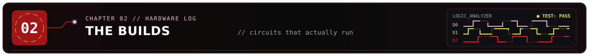

<!--
  KANISHK // GodFatherNix — profile README (cinematic edition)
  Animated scenes live in ./assets/*.svg inside this same repo.
-->

<!-- ═══════════════ SCENE 00 // OPENING ═══════════════ -->

<p align="center">
  <a href="https://github.com/GodFatherNix">
    
  </a>
</p>

<p align="center">
  
</p>

<p align="center">
  <a href="https://github.com/GodFatherNix?tab=repositories"></a>
  <a href="https://www.instagram.com/nisoska_san/"></a>
  <a href="mailto:kanishkj09@gmail.com"></a>
  <!-- Stack Overflow: replace YOUR_NUMERIC_ID, then uncomment
  <a href="https://stackoverflow.com/users/YOUR_NUMERIC_ID/GOD_OF_CODE"></a>
  -->
</p>

<p align="center">
  
  
  
</p>

<!-- ═══════════════ CHAPTER 01 // THE ENGINEER ═══════════════ -->

<p align="center">
  
</p>

```python
me = {
    "name": "Kanishk",
    "learning": ["electronics", "embedded systems", "PCB design"],
    "posting": ["projects", "experiments", "working circuits"],
    "rule": "If it doesn't run, I don't care.",
}
```

I learn best by building a circuit, testing it, and figuring out why it didn't work the first time.

<details>
<summary><b>🔦 Step onto the workbench — click to switch on the lights</b></summary>
<br />

<table>
  <tr><td><b>⚡ PCB design</b></td><td>EasyEDA and KiCad</td></tr>
  <tr><td><b>🧠 Embedded systems</b></td><td>Arduino and basic embedded logic</td></tr>
  <tr><td><b>🔩 Hardware</b></td><td>Sensors, transistors, buzzers, relays, and motors</td></tr>
  <tr><td><b>💾 Code &amp; version control</b></td><td>Git, with a bit of Python and C when I need them</td></tr>
</table>

</details>

<!-- ═══════════════ CHAPTER 02 // THE BUILDS ═══════════════ -->

<p align="center">
  
</p>

<p align="center">
  
</p>
<p align="center">
  <b>🚨 Intruder Alarm System</b> · Motion detection · Buzzer alert<br />
  A simple alarm circuit that sounds a buzzer when it detects motion.<br />
  <code>Motion sensor</code> <code>Buzzer</code>
</p>

<p align="center">
  
</p>
<p align="center">
  <b>🤖 Automation &amp; Control</b> · Workbench experiments<br />
  Small experiments with automation and control circuits. More builds coming as I test them.<br />
  <code>Arduino</code> <code>Relay</code> <code>Motor</code>
</p>

<p align="center">
  <a href="https://github.com/GodFatherNix?tab=repositories"></a>
</p>

> [!TIP]
> Everything here is part of the journey — raw, real, and mine.

<!-- ═══════════════ CHAPTER 03 // THE ARSENAL ═══════════════ -->

<p align="center">
  
</p>

<p align="center">
  
</p>

<p align="center">
  
  
</p>

<!-- ═══════════════ CHAPTER 04 // THE SIGNAL ═══════════════ -->

<p align="center">
  
</p>

<details>
<summary><b>📡 Tune in — stats, streak, and top languages</b></summary>
<br />

<p align="center">
  
  
</p>

<p align="center">
  
</p>

</details>

<!-- ═══════════════ FINAL SCENE // CREDITS ═══════════════ -->

<p align="center"><b>Building something with circuits or embedded systems? I'd love to hear about it.</b></p>

<p align="center">
  <a href="mailto:kanishkj09@gmail.com"></a>
</p>

<p align="center">
  
</p>
